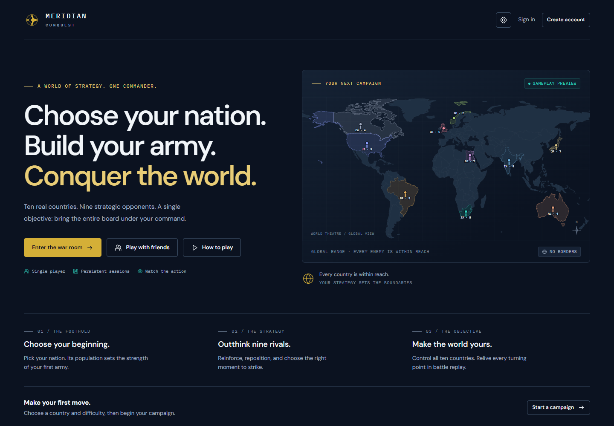

# Meridian Conquest

Meridian Conquest is a turn-based strategy web application developed for the
University of Cape Town's **INF4001N Entrance Exam for 2027**. Inspired by Risk,
it places ten real countries on a world map. Choose your starting country,
build your army and defeat nine opposing commanders to control all ten countries.

The required single-player mode includes strategic NPCs, population-based armies,
paired-dice combat and dynamic Gemini commentary. Multiplayer rooms, temporary
alliances, an interactive adviser tutorial, replay and live spectators extend
the same game rules.

**[Play the game](https://meridian-conquest.vercel.app)** ·
**[Source code](https://github.com/Muhammed112/Meridian_Conquest_UI)**

## Project status

The application is deployed on Vercel and uses Firebase Authentication, Cloud
Firestore and Firebase AI Logic. Firebase remains on the free Spark plan; the
deployment does not use Cloud Functions or a personal Gemini API key.

The latest application release, published on **5 November 2026**, is commit
[`c10feed`](https://github.com/Muhammed112/Meridian_Conquest_UI/commit/c10feed).
It includes the opening turn-order preview, **Alliance** label, compact action
panels, updated report sharing and live-view presence notices. Its matching
Firestore rules are deployed.

Release checks passed formatting, lint, **273 unit tests** and **18 Firestore
permission tests**. Post-deployment checks matched 304 non-audio public files to
the local source, confirmed seven private paths were unavailable, and checked the
homepage and opening-order preview in a browser. The opening-order deployment
check used a cloud-disabled fixture without creating a real campaign.

## Preview



The welcome map demonstrates attacks, transfers and captures using an in-memory
board, without creating saved campaigns or requesting AI commentary. Real
campaigns provide a country roster, interactive map, turn controls and separate
Field reports and AI commentary tabs.

## Features

- **Single-player campaigns:** choose a country, draw nine distinct rivals and
  maintain independent saves. Search countries and search/filter campaigns.
- **Strategic opponents:** Easy, Medium, Hard and Extreme difficulty levels.
  NPC decisions include explanations that remain visible in fast-forward.
- **Combat presentation:** paired dice, delayed casualty reveals, troop movements,
  distant-attack planes, capture effects, music and sound controls.
- **Opening dice:** roll for the first turn, resolve ties and review the numbered
  turn order before starting.
- **AI commentary:** automatic narration for human and bot battles, with event
  priorities, saved reports and factual fallback.
- **Interactive tutorial:** Captain Mara welcomes the commander, types rules
  and examples, and points to the next control during guided practice.
- **Alliances:** negotiate three-round NPC pacts without combining armies or
  changing the victory condition.
- **Multiplayer:** room codes, searchable country reservations, individual
  opening rolls and bots for empty seats.
- **Sharing and replay:** anonymous read-only live viewing, player-left notices,
  completed-game recordings and chronological replay controls.
- **Accounts and saves:** player nicknames, password reset, private cloud saves,
  browser recovery copies and protection against competing saves.

## Technology and structure

| Area         | Implementation                                                     |
| ------------ | ------------------------------------------------------------------ |
| Frontend     | HTML, CSS and native JavaScript ES modules; no build step          |
| Rules        | Separate game, battle and NPC strategy modules                     |
| Database     | Cloud Firestore, an online NoSQL document database                 |
| Accounts     | Firebase Authentication with email/password sign-in                |
| AI           | Gemini through Firebase AI Logic and App Check                     |
| Hosting      | Vercel static hosting of `dist`                                    |
| Verification | Node.js tests, Playwright, Firestore emulator, ESLint and Prettier |

The maintained browser source lives in `dist`; this is not a generated or
minified build folder.

```text
dist/                  Browser application, game logic and bundled assets
  controllers/         Player actions, campaign loading and NPC playback
  ui/                  Shared views, tutorial, reports and map components
scripts/               Development server, data tools and browser checks
tests/                 Unit tests and isolated Firestore permission tests
docs/                  Architecture, database, setup and tutorial documentation
functions/             Optional server-side commentary alternative; not deployed
```

See [architecture](docs/ARCHITECTURE.md) for module responsibilities and
[database design](docs/DATABASE.md) for collections, immutable event history,
save revisions and compatibility with existing campaigns.

## Installation

### Requirements

- Node.js **24**, as specified in `.nvmrc`, with npm.
- A modern browser with JavaScript and browser storage enabled. Desktop Chrome
  is a supported development/test environment.
- Internet access for accounts, cloud saves, multiplayer, live viewing and AI.
  Country metadata, flags, map geometry and audio are bundled.
- Java **21 or later** only if running Firestore emulator tests.

### Run locally

Clone the repository:

```sh
git clone https://github.com/Muhammed112/Meridian_Conquest_UI.git
cd Meridian_Conquest_UI
```

For the submission ZIP, extract it and open a terminal in the folder containing
`package.json` instead. Install the locked dependencies and start the server:

```sh
npm ci
npm run dev
```

Open **http://localhost:8081**. The terminal prints the actual address. The server
binds only to your computer. No build command or administrator CLI login is
required for ordinary gameplay and account sign-in.

To use port **8082**, or another available port, in PowerShell:

```powershell
$env:MERIDIAN_PORT = '8082'
npm run dev
```

### Local AI setup

Local commentary needs an App Check development attestation. An operator with
access to the configured Firebase project can run:

```sh
npx firebase login
npm run dev
```

The development server registers or reuses a private token under the ignored
`.firebase` directory and serves it only on loopback. Static hosting serves an
empty local-configuration stub. Reviewers without operator access can use the
deployed site for commentary; an ordinary player does not need project
administration access.

See [Firebase setup](docs/FIREBASE.md) to configure another project. A plain
static server can serve `dist`, but use `npm run dev` for local AI setup and
background population updates.

## Usage

### Start a single-player campaign

1. Create an account or sign in. Choose a player nickname; change it later through
   **Settings → Player nickname**.
2. New players with no saves are offered the interactive tutorial. Skip it or
   replay it through **How to play** or **My campaigns**.
3. Choose **New campaign**, enter a name, select a difficulty and search for your
   starting country. Nine other countries are drawn randomly.
4. Select **Roll my die**. All ten commanders roll; **Roll tie-break** rerolls only
   tied leaders when necessary.
5. Review the numbered **Turn order**, then select **Start campaign**. The winner
   takes the first turn; remaining turns follow seat order from that winner.

For example, if Atlas wins the opening roll, the preview lists Atlas first and
then the remaining commanders in the same rotation the game will use. Existing
campaigns retain their saved turn order and recorded player names.

### Play a turn

Select countries through the map, roster or action-panel controls. The roster
shows flags, abbreviations, ownership and soldiers, grouped by commander with
the largest holdings first.

| Rule                | Behaviour                                                                                                                                           |
| ------------------- | --------------------------------------------------------------------------------------------------------------------------------------------------- |
| Reinforcements      | From round two, receive two soldiers per owned country and allocate them before planning.                                                           |
| Attack              | Select an owned country with at least two soldiers and any enemy target, regardless of borders or distance.                                         |
| Dice pairs          | Both sides roll `min(attacker soldiers − 1, defender soldiers)` dice. Compare matching pairs; the lower die loses a soldier and ties cause no loss. |
| Continue or retreat | Continue the same attack until conquest, retreat or one attacking soldier remains. Stopping an attack ends the turn.                                |
| Conquest reward     | Gain `max(2, floor(original country soldier value / 2))` soldiers; one earned soldier garrisons the captured country.                               |
| Transfers           | Move soldiers between your countries outside an active attack, retaining at least one at the origin.                                                |
| Attack allowance    | One attack target per turn. Attacking is optional.                                                                                                  |
| Victory             | A commander with no countries is eliminated. One commander must own all ten to win.                                                                 |

Bots normally display decisions for five seconds. Single-player **Fast forward**
shortens the pause while retaining gameplay and explanations. Replay autoplay
also uses five-second steps, with pause and previous/next controls. Dice reveal
recorded results after their animation; animation never determines outcomes.

### Reports, commentary and settings

**Field reports** contains factual decisions and battle outcomes.
**AI commentary** contains narration. Enable it in Settings to narrate recent
eligible action and new events automatically. **Generate commentary** is an
optional retry.

**Pin reports** bounds the feed and scales the map proportionally above it with
a small gap. The map and reports remain together in the page layout and move
together when the page scrolls. Messages scroll inside the report area. Use the
arrow to collapse/expand the feed or **Unpin** to restore the normal layout.
Incoming narration updates the feed without replacing the board.

Settings also contains animation preferences, music/effect volumes, mute,
audio credits and nickname controls. Full animations are enabled by default;
reduced motion shows results without tumbling or moving effects. Sound starts
after a user interaction, following browser autoplay controls.

### Alliances

During a clear planning phase, select **Alliance** in the right action panel.
Choose an NPC and offer a three-round pact. Their decision considers strength,
common threats and trust. The panel shows accepted pacts and remaining rounds;
the allied roster group also has an indicator.

Commanders keep their own armies and turns. Attacking an ally breaks the pact
and lowers trust. It expires after three rounds, when either ally is eliminated,
or when only the allies remain. Human-to-human proposals are outside this version.
See [alliance rules](docs/DIPLOMACY.md); that guide uses the original term
“Diplomacy” for the same feature.

### Multiplayer

1. Open **Multiplayer**, create a room and share its six-character code.
2. Each signed-in friend reserves a different country using the searchable field.
   Their account nickname carries into the room.
3. The host selects **Roll for first turn**. Empty seats receive countries and
   automatic bot rolls; each human selects **Roll my die**.
4. Resolve ties, review the turn order and let the host start the match.

Multiplayer uses the single-player game screen with controls relative to each
viewer. Keep the host's room open for bot turns. Returning members can sign in
and rejoin using the same code. Started matches retain their countries and order;
room membership and turn permissions restrict who can act.

### Live viewing and completed gameplay

For an ongoing signed-in single-player campaign, use **Share live link** in the
reports header or the campaign-card share icon. Visitors open the `#live/` link
without signing in and see the board, up to 60 recent events and available
commentary. They cannot play turns or negotiate.

The owner must keep the game open for play to continue. Leaving shows
**The player has left the game** above the retained position. An abrupt close or
network loss can take about 80 seconds to detect; switching tabs alone does not
mark the player offline. **Stop sharing** revokes the live link without deleting
the private campaign.

Completed campaigns use **Share gameplay**. Their `#watch/` links contain a fixed
copy of the final board, up to 60 recent events and saved commentary. They work
after the owner leaves and cannot be revoked. **Stop live sharing** separately
revokes an earlier live link. Private replay retains the owner's full saved
history. Public spectator links apply to single-player; multiplayer rooms remain
member-only.

## Population data

The catalogue contains **233 countries and territories**. Figures come from the
brief's [Worldometers population table](https://www.worldometers.info/world-population/population-by-country/).
Setup displays exact counts, estimate year and snapshot date. Starting-army bands
use unrounded annual estimates:

| Population, inclusive upper bound | Starting soldiers |
| --------------------------------- | ----------------: |
| 5 million                         |                 1 |
| 10 million                        |                 2 |
| 25 million                        |                 3 |
| 50 million                        |                 4 |
| 75 million                        |                 5 |
| 100 million                       |                 6 |
| 125 million                       |                 7 |
| 150 million                       |                 8 |
| Above 150 million                 |                 9 |

The app starts with a bundled snapshot and keeps working data when source checks
fail. The development server checks in the background, at most daily after a
successful refresh; failures can retry after an hour. The **Update country
populations** GitHub workflow is scheduled for 05:23 UTC daily and needs the
restricted updater account's repository secrets and enabled GitHub Actions.

Updates affect new games and unsaved setups. Existing saves retain populations,
original army values and rewards. Missing countries, older data, changed source
structure and unexpected changes above 25% are rejected.

| Operator command              | Purpose                                                                  |
| ----------------------------- | ------------------------------------------------------------------------ |
| `npm run populations:update`  | Refresh the bundled offline snapshot.                                    |
| `npm run catalogue:refresh`   | Regenerate country metadata and the snapshot.                            |
| `npm run populations:publish` | Publish a validated public reference using Firebase CLI operator access. |

Review generated changes before publishing. See
[population setup and recovery](docs/FIREBASE.md#population-updates).

## AI behaviour and limitations

The configured model is `gemini-3.5-flash-lite`, accessed through Firebase AI
Logic. Narration uses event-time facts and impartial third-person wording for
the whole match, including bot-versus-bot battles. Only the multiplayer host
generates shared room reports; spectators do not request narration.

Each match keeps its most important pending event, preferring the newest on equal
priority. Victories, eliminations and captures outrank routine exchanges. Stale
requests are skipped so commentary does not hold up play. Reports are saved by
event ID and reused on reload or replay. Entering a campaign prepares Gemini
and App Check without generating an extra report.

Verification anchors and wording checks reject detected contradictions and
premature outcomes before saving reports, but cannot prove every sentence
correct. Latency and provider quotas still apply. Factual reports continue if
AI is disabled, slow or unavailable.

Firestore enforces ownership, membership, turns, revisions and bounded move
validation. Dice and full combat calculations run in the browser; there is no
authoritative competitive game server. NPC battle safety limits are 20 phases
in single-player and 30 in multiplayer, with a recorded regrouping explanation.

## Testing and code quality

Install dependencies with `npm ci` before running checks.

| Command                      | Purpose                                                                                         |
| ---------------------------- | ----------------------------------------------------------------------------------------------- |
| `npm run check`              | Formatting, ESLint and all unit tests.                                                          |
| `npm test`                   | Unit tests for rules, saves, rooms, commentary and presentation.                                |
| `npm run test:ai`            | Offline commentary-validation examples; no Gemini requests.                                     |
| `npm run browsers:install`   | Install Playwright Chromium for browser checks.                                                 |
| `npm run test:browser`       | Local gameplay, map, setup, tutorial, report and spectator browser fixtures.                    |
| `npm run test:rules`         | Firestore permissions in the isolated `demo-meridian` emulator on port 8180. Requires Java 21+. |
| `npm run commentary:preview` | Real-Gemini evaluation; requires the dev server/operator setup and consumes model quota.        |

Ordinary unit, browser and emulator suites need no production accounts or Gemini
generation requests. The browser helper can also use installed Chrome;
`MERIDIAN_BROWSER_PATH` selects another executable. Separate live-integration
scripts can create temporary accounts and data; read their instructions first.
See [contributor checks](CONTRIBUTING.md#checks) for test scope and setup details.

## Deployment

Vercel serves `dist` through `vercel.json`: framework **Other**, no build/install
commands and no server functions. The production hostname is registered with
Firebase Authentication and App Check.

For an operator already signed in and linked to the existing Vercel project:

```sh
npm run check
npx vercel deploy --prod
```

Vercel deployment does not push Git commits or publish Firestore permissions.
Automatic deployment from GitHub is not connected. Test and publish changed
database rules separately when releasing compatible frontend changes:

```sh
npm run test:rules
npx firebase deploy --only firestore:rules,firestore:indexes --project meridian-conquest-m112
```

This publishes rules/indexes, not Firebase Hosting or Functions. See
[Vercel setup](docs/VERCEL.md) for linking another computer and registering a
new hostname.

## Support and troubleshooting

Use the [GitHub issue tracker](https://github.com/Muhammed112/Meridian_Conquest_UI/issues)
to report reproducible problems. Include the URL, browser, game mode, action,
expected result and visible error. Do not include passwords or tokens.

| Problem                                       | First check                                                                 |
| --------------------------------------------- | --------------------------------------------------------------------------- |
| Old labels or layout                          | Refresh with **Ctrl+F5**.                                                   |
| Local port already in use                     | Set `MERIDIAN_PORT` to a free port and restart the server.                  |
| Local commentary unavailable                  | Use `npm run dev` and check operator App Check setup, or use the live site. |
| Campaigns seem missing                        | Check the signed-in account; saves are account-specific.                    |
| Shared localhost link fails on another device | Share from the deployed site instead.                                       |
| Multiplayer bot turns stop                    | Keep the host's room open and connected.                                    |
| Emulator rejects Java                         | Confirm `java -version` reports Java 21+ on this terminal's PATH.           |

Further help: [Firebase guide](docs/FIREBASE.md) and
[tutorial coverage](docs/TUTORIAL.md).

## Roadmap

Possible future work includes a trusted backend for competitive anti-cheat,
broader human-reviewed AI evaluations and further readability improvements on
short desktop windows. These are future options, not implemented features.

## Contributing

This repository is maintained as a university assignment. Discuss substantial
changes through an issue before opening a pull request. Follow
[CONTRIBUTING.md](CONTRIBUTING.md): separate rules from presentation, reuse shared
logic, explain non-obvious code, preserve saves and run appropriate checks.

Exclude `.firebase/`, `.vercel/`, `.git/`, credentials, debug tokens, logs and
`node_modules/` from the submission ZIP. Supply application test credentials
and examiner database access through the required submission channel, not in
source.

## Author and acknowledgements

Developed by [Muhammed (Muhammed112)](https://github.com/Muhammed112) for the
INF4001N entrance assignment. Testers helped identify pacing, tutorial,
country-label and report-layout issues. The interface builds on the supplied
Figma design.

| Resource           | Source and acknowledgement                                                                                 |
| ------------------ | ---------------------------------------------------------------------------------------------------------- |
| Population figures | Worldometers, as specified in the brief.                                                                   |
| Country metadata   | [mledoze/countries](https://github.com/mledoze/countries), ODbL 1.0.                                       |
| World map          | world-atlas and Natural Earth; ISC package licence and public-domain geometry.                             |
| Flags              | [flag-icons 7.3.2](https://github.com/lipis/flag-icons/tree/v7.3.2), MIT licence.                          |
| Music              | Kevin MacLeod: Decisions, Lost Frontier and Mechanolith, CC BY 4.0; credits also appear in Sound settings. |
| Sound effects      | Kenney CC0 samples and original Web Audio cues.                                                            |

## License

No separate project-wide open-source licence is included for the original
application source. Third-party materials retain their own licences and credits:

- [Country metadata credits](dist/assets/COUNTRY_DATA_CREDITS.txt) and
  [ODbL licence](dist/assets/COUNTRY_DATA_LICENSE.txt).
- [world-atlas licence](dist/assets/world-atlas-LICENSE.txt).
- [flag-icons licence](dist/assets/flags/LICENSE).
- Music attribution in the application's **Settings → Sound** credits.

Keep these notices with the relevant assets when preparing the submission.
