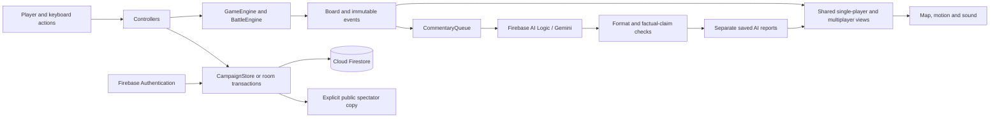

# Application architecture

Meridian Conquest uses browser ES modules and Firebase. Maintained frontend source
lives in `dist`; the name does not imply a generated or minified build. Views,
controllers, domain rules and persistence have explicit boundaries. A framework
or inheritance hierarchy is unnecessary for these responsibilities.

## Responsibilities

| Module                         | Owns                                                 | Boundary                                                   |
| ------------------------------ | ---------------------------------------------------- | ---------------------------------------------------------- |
| `app.js`                       | Composition, route selection and rendering           | Reads current services through context getters             |
| `controllers/campaigns.js`     | Selected-history loading and recovery reconciliation | Never combines competing histories silently                |
| `controllers/settings.js`      | Nickname edits, preferences and status controls      | Reads the current account when an action runs              |
| `controllers/events.js`        | DOM event dispatch                                   | Routes moves to the game or room service                   |
| `controllers/npcs.js`          | Bot playback and reading pauses                      | Cancels when the route, campaign or permissions change     |
| `engine.js`                    | Legal moves, combat, rewards, turns and victory      | Does not depend on Firebase or the DOM                     |
| `npc-strategy.js`              | Deterministic board evaluation                       | Plans without changing the board or dice                   |
| `campaign-store.js`            | Board summaries, lazy history and versioned saves    | Owns private session, record and history state             |
| `rooms.js` and `room-setup.js` | Multiplayer transactions and opening rolls           | Membership and revision checks precede updates             |
| `game-schema.js`               | Storage codecs and validation                        | Supports existing records without rewriting them on reads  |
| `commentary.js`                | Bounded queue, priorities, caching and Gemini setup  | Narration cannot change game rules                         |
| `commentary-validation.js`     | Verification anchors and explicit claim checks       | Rejects detected contradictions before persistence         |
| `game-summary.js`              | Ranked recorded facts and recap response validation  | Uses available history without trusting prior AI wording   |
| `ui/game-summary.js`           | On-demand recap dialog and bounded account cache     | Never saves reports or changes live-commentary preferences |
| `ui/`                          | Escaped markup, focus restoration and layout         | Uses presentation copies during dice reveals               |

`GameEngine`, `BattleEngine`, `NpcStrategy`, `CampaignStore`, `CommentaryQueue`,
`MotionDirector` and `SoundDirector` encapsulate coherent responsibilities.
Campaign storage and queue bookkeeping use private class fields. Queue observers
receive copies of collections; they cannot clear pending requests or change
deduplication state. The engine retains its existing board getter for compatible
rendering and serialization. Gameplay controllers invoke engine methods rather
than duplicating battle calculations.

## Interaction and failure handling

Campaign cards require board summaries only. Opening a game or replay loads that
campaign's event history in pages of at most 250 documents. A failed history has
its own retry screen, while other games and new campaigns remain usable.
Complete browser recovery caches are preserved independently of partial lists.

Active campaign cards offer **Resume campaign** without Replay or a control to
start sharing. **Share live link** belongs to the active game's reports header.
Completed cards offer **Replay**, **Share gameplay** and **View results**. A card
for an already public game retains its stop-sharing control so revocation remains
available independently of the game's status.

Live shares use a five-minute lease on the public copy's server `updatedAt` time.
Game changes and throttled owner input renew it; presence heartbeats do not.
Firestore rules deny expired visitor reads even after the owner closes the browser.
Visitor timers also remove an already displayed board at its deadline. Expired
copies remain owner-only until renewed by explicit sharing or deleted; the private
campaign and standalone completed-game recordings are unaffected.

A second device cannot silently overwrite a versioned save. Conflicts stop cloud
writes for that campaign, keep the current local recovery data and offer an
explicit reload. Loading a competing history first preserves the local branch in
a separate browser recovery entry. These copies remain on that browser; clearing
site storage removes them.

Before replacing the board markup, rendering captures the active control's
identity and text selection. It restores the equivalent usable control without
scrolling. When a completed action replaces its controls, focus moves to the new
action heading. Tutorial step focus and open dialogs retain precedence.

## AI preparation and correctness

Entering a private campaign or hosted multiplayer match prepares the model,
App Check attestation and cached authentication token when commentary is enabled.
Preparation makes no Gemini generation request. It reduces setup work on the
first report; provider response time and quotas still apply.

Requests include event-time facts and verification anchors. Responses must copy
those anchors exactly. Additional checks detect several explicit casualty-count
errors, reversed loss comparisons, premature outcomes, sports imagery and viewer-directed
wording. Recorded nicknames are excluded from wording checks. A detected contradiction is not saved as AI commentary. These checks
cannot establish the truth of every possible natural-language sentence. Human
review of live reports remains part of quality evaluation.

Replay **AI summary** is a separate, explicit signed-in request. It pauses playback
and uses the existing Gemini and App Check setup with its own recap prompt and
response schema; the live-commentary preference is neither required nor changed.
`game-summary.js` ranks structured events across the available history, validates
the returned source IDs and restores chronological order. A successful recap selects five
to eight concrete highlights when enough exist, never more than eight, and links
each to its exact recorded replay event. Highlights stay hidden while generation
is pending; signed-out viewers and failed requests receive a factual fallback.

`ui/game-summary.js` coalesces duplicate requests and keeps up to eight cached
entries in account-scoped page memory. Changed recordings use a new cache key;
account changes clear the cache and invalidate outstanding presentations. Closing
or replacing the dialog prevents late responses from overwriting another screen.
The recap writes no Firestore reports or campaign data. Shared live copies and
embedded recordings contain at most 60 recent events, so their recap explicitly
covers the available snapshot rather than claiming to reconstruct the full match.

## Trust and cost boundary

Firebase remains on Spark. Authentication and rules enforce storage ownership,
membership and permitted transitions. Multiplayer rules additionally constrain
troop totals, captures, reinforcement destinations and spending, two-country
transfers, round advancement and attack resets. Dice and full combat calculations
are checked by the browser engine rather than an authoritative server.
Free-form AI text is not independently authoritative. Complete competitive
anti-cheat requires a trusted game service; this implementation does not claim it.

See [database design](DATABASE.md) and [contributor guidance](../CONTRIBUTING.md)
for schema and verification details.
