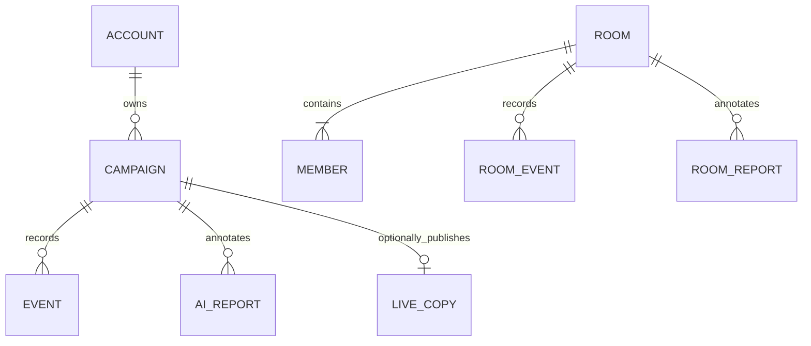

# Database design

Cloud Firestore is the project's online NoSQL document database. A campaign has a
small changing board, an expanding event history and independent generated
reports. Documents and subcollections fit these access patterns. Firebase
Authentication manages credentials; application passwords are not stored in
Firestore.

The relationships describe document ownership and references rather than SQL
joins or foreign-key constraints.

| Path                                 | Stored data                                                                  | Access                                                 |
| ------------------------------------ | ---------------------------------------------------------------------------- | ------------------------------------------------------ |
| `users/{uid}/games/{gameId}`         | Typed board, display fields, legacy payload and save metadata                | Signed-in owner                                        |
| `…/events/{eventId}`                 | Sequence, typed factual event, previous-event link and legacy context        | Owner reads and creates; existing facts are immutable  |
| `…/aiReportsV2/{eventId}`            | Event reference, generated text, model, version, author and server timestamp | Owner reads and creates once                           |
| `rooms/{code}`                       | Members, country reservations, opening dice and current shared board         | Signed-in invitation-code access; controlled updates   |
| `rooms/{code}/events/{eventId}`      | Immutable move facts                                                         | Members read; current controller commits               |
| `rooms/{code}/aiReportsV2/{eventId}` | Shared commentary                                                            | Members read; host creates once                        |
| `liveGames/{gameId}`                 | Allowlisted, bounded public gameplay copy                                    | Visitors read a known link; owner publishes or revokes |
| `publicData/populations`             | Validated reference snapshot                                                 | Public read; dedicated updater writes                  |

## Board and event fields

`schemaVersion: 2` selects the typed storage codec. `board.countryCodes` fixes the
ten-country roster, `board.origins` retains original populations and reward
values, and `board.countries` contains changing ownership and soldier counts.
The board also records order, round, turn budget, attack state, battle and winner.
Top-level `name`, `status`, `round` and `updatedAt` support listing and future
database-side filtering. Current list filtering runs over board summaries.

New committed saves have a positive `saveRevision` and a `historyHead` identifying
their last event, or `null` for an empty history. New event documents include
`previousEventId`, linking each event to its predecessor. Event IDs remain stable.
Commentary is excluded from factual event records and stored separately.

## Loading and saving

1. Sign-in reads board summaries and validates each one independently. An invalid
   document is reported and left untouched.
2. Opening a campaign reads only its history, ordered by `sequence`, in pages of
   at most 250 documents. Loading another campaign is independent.
3. The reader follows `historyHead` and predecessor links. This selects the
   committed branch and excludes staged uploads from interrupted or competing
   saves. A cycle or missing committed event produces a retryable history error.
4. Saving stages new immutable event documents in batches of at most 400. A retry
   remembers existing uploads and does not rewrite immutable facts.
5. A transaction compares the last observed board version and commits the new
   board, incremented revision and history head only if it is unchanged. A
   competing writer receives a conflict instead of replacing newer progress.

Staging and head selection allow histories larger than one write batch. A failed
upload leaves the previous committed board readable. Unreferenced staged events
are retained rather than deleting player data. A future maintenance operation
could remove verified unreferenced events after a retention period; ordinary
gameplay performs no such deletion.

## Compatibility strategy

Existing records without revision or head fields remain readable. Their original
events are not rewritten. New predecessor chains can terminate at an existing
legacy event; the earlier ordered legacy history remains intact. A normal save
adopts versioned writes. Once versioned, rules reject stale revisions and writers
that try to remove revision metadata.

Release this writer with its matching Firestore rules and update every supported
frontend before allowing versioned saves. Publishing the frontend against the
previous rules rejects the new metadata fields. Existing browser tabs must refresh
before writing an upgraded campaign. Older readers do not understand committed
history branches, even though the legacy board payload remains present. This is
a coordinated client release, not a bulk rewrite of existing campaigns.

The legacy JSON `payload` remains dual-written while older deployed clients may
read it. Removing it requires a separately planned migration: inventory client
versions, update every supported deployment, confirm typed readers cover existing
saves, retain a backup and only then remove compatibility writes. Formatting or
routine feature work must not delete the old fields in bulk.

## Indexing, limits and permissions

Large board, payload and event-map fields use index exemptions in
`firestore.indexes.json`. Sequence ordering uses its ordinary field index.
History grows in separate documents instead of a single unbounded game document.
Spectator payloads are bounded, allowlisted copies with at most 60 recent events.

Private campaigns remain owner-only. Public viewing requires explicit sharing;
revocation removes the public copy. A room code serves as an invitation.
Multiplayer rules validate membership, controller, revisions, starting data and
bounded move arithmetic. Outside combat, changed armies must belong to the active
seat, owners stay fixed and totals remain conserved plus the exact reinforcement
budget. Funding cannot reduce existing armies; a transfer changes exactly two
owned countries and leaves valid garrisons. Rounds advance only when the turn
position wraps. Fixed-size delta lists keep these checks within Firestore's
evaluation limit, including reinforcement across nine countries. Fair dice and
complete combat calculations remain browser trust boundaries. These rules do not
replace a trusted game server.

`npm run test:rules` exercises permissions in the isolated `demo-meridian`
emulator. It does not modify the connected production database.
